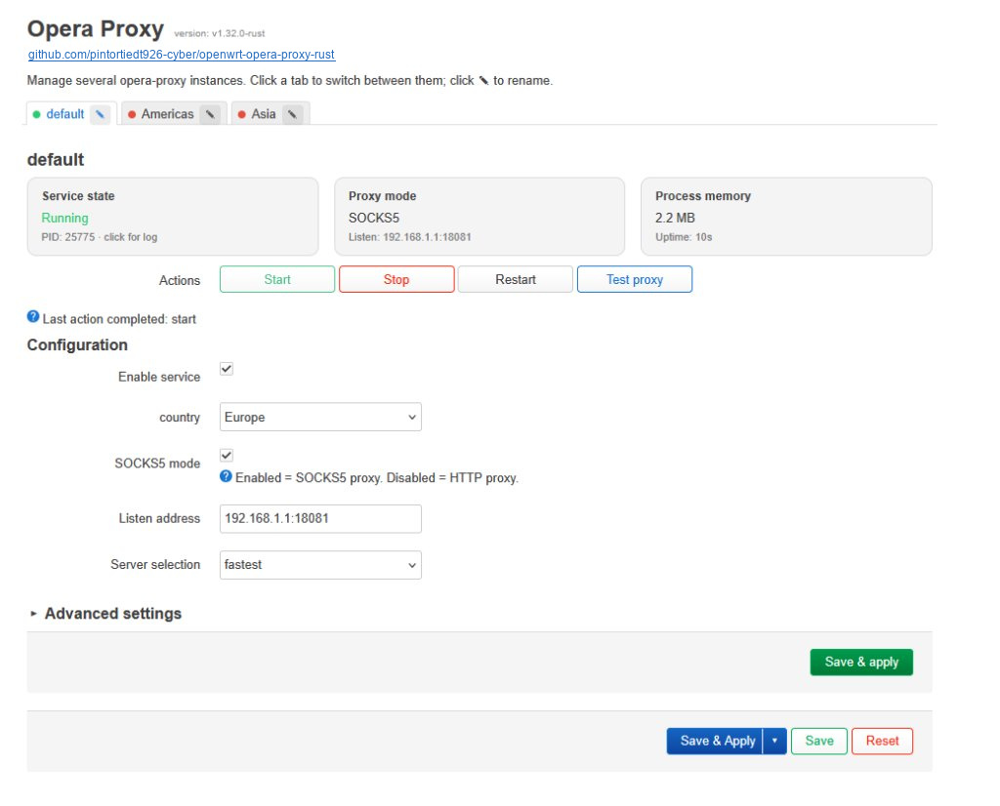

# Opera Proxy для OpenWrt — порт на Safe Rust

Лёгкий клиент **Opera Proxy** (HTTP / HTTPS CONNECT / SOCKS5), переписанный с Go на **безопасный Rust** специально для роутеров OpenWrt с ограниченной оперативной и flash-памятью.

Полностью совместим с существующей конфигурацией UCI (`/etc/config/opera-proxy`), init-скриптом `procd` (`/etc/init.d/opera-proxy`), многоинстансным запуском и веб-интерфейсом **`luci-app-opera-proxy`**.

- Базовый Go-оригинал (поведенческий эталон): [Alexey71/opera-proxy](https://github.com/Alexey71/opera-proxy) (`v1.32.0`, коммит `41ae3198`)
- Базовая упаковка и LuCI: [recrumptor/openwrt-opera-proxy-bin](https://github.com/recrumptor/openwrt-opera-proxy-bin) (коммит `81cef91c`)

---

## Сравнение Go и Safe Rust (реальные замеры на роутере)

Замеры выполнены на реальном роутере **GL.iNet Flint 2 (MT6000)** (`mediatek/filogic`, `aarch64_cortex-a53`, OpenWrt `24.10.1`, Linux `6.6.86`) в одинаковых условиях, без UPX-сжатия.

| Показатель | Оригинал на Go (`v1.32.0`) | Safe Rust (`v1.32.0-rust`) | Выигрыш |
| :--- | ---: | ---: | :--- |
| **Бинарник ARM64 (`aarch64_cortex-a53`), без UPX** | 7.31 MiB (7 667 872 Б) | **2.26 MiB** (2 371 888 Б) | **в 3.23× меньше** |
| **Пакет `.ipk` / `.apk` ARM64, без UPX** | ~2.5 MiB *(требовал UPX)* | **1.28 MiB** *(без UPX)* | **в ~2× меньше** |
| **Бинарник MIPSEL (`mipsel_24kc`), без UPX** | 8.75 MiB (9 175 231 Б) | **3.36 MiB** (3 521 344 Б) | **в 2.61× меньше** |
| **Пакет `.ipk` / `.apk` MIPSEL, без UPX** | ~2.5 MiB *(требовал UPX)* | **1.43 MiB** *(без UPX)* | **меньше без UPX** |
| **Память `VmRSS` — 1 инстанс HTTP (простой)** | 14.68 MiB (15 028 КБ) | **2.0–2.35 MiB** (2 020–2 404 КБ) | **в 6.2–7.3× меньше RAM** |
| **Пик `VmHWM` (10 паралл. запросов + 2 MiB)** | 15.30 MiB (15 668 КБ) | **2.85 MiB** (2 916 КБ) | **в 5.37× меньше RAM** |
| **Память `VmRSS` — 1 инстанс SOCKS5** | 14.09 MiB (14 424 КБ) | **2.08–2.23 MiB** (2 132–2 288 КБ) | **в 6.3–6.8× меньше RAM** |
| **3 инстанса одновременно (суммарный `VmRSS`)** | ~44–46 MiB | **7.07 MiB** (7 240 КБ) | **в ~6.2× меньше RAM** |
| **Виртуальная память `VmSize` *(виртуальный резерв `VSZ`, не физическая RAM)* / OS-потоки** | 1.21 GiB / 9–10 потоков | **4.60 MiB / 1 поток** | **в 269× меньше `VSZ`** |
| **Открытые файловые дескрипторы (до → после)** | 10 → 11 | **10 → 10** (утечек нет) | Чисто |
| **10 параллельных HTTPS CONNECT** | 10 / 10 | **10 / 10** | Паритет |
| **30 запросов (soak-тест, 3×10 паралл.)** | — | **30 / 30** (HTTP 204) | Стабильно |
| **Скачивание 2 MiB (HTTP CONNECT / SOCKS5h)** | 2.97 / 1.38 МБ/с | **3.28 / 1.36 МБ/с** | Паритет |
| **Завершение по `SIGTERM`** | код `0` | код **`0`** | Чисто |

> **Почему без UPX:** несжатый Rust-бинарник и так меньше, чем Go-бинарник после UPX, при этом отсутствие UPX позволяет Linux подгружать исполняемый код постранично без распаковки всего бинарника в оперативную память.

---

## Поддерживаемые платформы и версии OpenWrt

| OpenWrt | Формат | `aarch64_cortex-a53` (`mediatek/filogic`) | `mipsel_24kc` (`ramips/mt7621`, soft-float) |
| :--- | :---: | :--- | :--- |
| **23.05.*** | `.ipk` | Поддерживается (`ring-crypto`, static musl) | Поддерживается (`pure-rust-crypto`, MIPS32r2 soft-float, static musl) |
| **24.10.*** | `.ipk` | **Проверено на реальном MT6000** (`opkg`, `procd`, LuCI, live VPN) | Собрано, проверен ELF/soft-float ABI (`fp_abi=3`) и тесты |
| **25.12.*** | `.apk` | Проверено через официальный `apk-tools 3.0.5` | Собрано и проверено по ELF/soft-float ABI |

Примеры устройств:
- **`aarch64_cortex-a53` (`mediatek/filogic`)**: GL.iNet Flint 2 (MT6000), Xiaomi AX3000T / Redmi AX6000, ASUS TUF-AX4200, Cudy WR3000.
- **`mipsel_24kc` (`ramips/mt7621`)**: Keenetic Viva / Giga (KN-1810), Xiaomi Mi Router 3G / 4A Gigabit / AC2100, Ubiquiti EdgeRouter X.

---

## Установка на роутер

Готовые проверенные пакеты и контрольные суммы лежат в папке [`releases/v1.32.0-rust/`](releases/v1.32.0-rust/) ([`SHA256SUMS.txt`](releases/v1.32.0-rust/SHA256SUMS.txt)).

Скопируйте нужный пакет `opera-proxy` (под вашу архитектуру и версию OpenWrt) и пакет `luci-app-opera-proxy` в `/tmp` на роутере.

### OpenWrt 23.05.* и 24.10.* (`opkg`, `.ipk`)

```sh
opkg install /tmp/opera-proxy-*.ipk /tmp/luci-app-opera-proxy_*.ipk
/etc/init.d/opera-proxy enable
/etc/init.d/opera-proxy start
```

### OpenWrt 25.12.* (`apk`, `.apk`)

```sh
apk add --allow-untrusted /tmp/opera-proxy-*.apk /tmp/luci-app-opera-proxy-*.apk
/etc/init.d/opera-proxy enable
/etc/init.d/opera-proxy start
```

После установки веб-интерфейс появится в LuCI: **Services → Opera Proxy**.
Проверка версии установленного бинарника:
```sh
opera-proxy -version
# v1.32.0-rust
```

---

## Конфигурация и использование

Файл конфигурации: `/etc/config/opera-proxy` (помечен как `conffiles` — не затирается при обновлении пакета).

```text
config instance 'default'
  option enabled '1'
  option args '-bind-address 127.0.0.1:18081'

config instance 'Americas'
  option enabled '0'
  option args '-bind-address 127.0.0.1:18082 -country AM -socks-mode'

config instance 'Asia'
  option enabled '0'
  option args '-bind-address 127.0.0.1:18083 -country AS -socks-mode'
```

### Подключение из браузера (ZeroOmega / SwitchyOmega)
По умолчанию прокси слушает `127.0.0.1:18081` (только внутри роутера — удобно для локальных клиентов вроде Podkop). Чтобы подключаться напрямую с ПК в домашней сети:
1. В LuCI → **Services → Opera Proxy** поменяйте `Listen address` на LAN-адрес роутера, например **`192.168.1.1:18081`** (снаружи из WAN порт останется закрыт), и нажмите **Save & apply**.
2. В ZeroOmega укажите протокол **SOCKS5** (если включён `SOCKS5 mode`) или **HTTP**, сервер `192.168.1.1`, порт `18081`.

### Пример Outbound для Podkop
```json
{
  "type": "http",
  "server": "127.0.0.1",
  "server_port": 18081
}
```

---

## Безопасность и известные особенности

- Весь исходный код порта написан на безопасном Rust (без `unsafe`-блоков), без `glibc` и без `OpenSSL` (полностью статическая линковка с `musl`).
- **Строгая проверка TLS-сертификатов**: проверка сертификатов никогда не отключается.
  - Для прокси-узлов Opera (`*.sec-tunnel.com`) поддерживается и пустой, и пользовательский `-fake-SNI` с одновременной строгой WebPKI-проверкой сертификата по реальному имени узла (`webpki-roots` или `-cafile`).
  - Для API `api2.sec-tunnel.com` в стандартном режиме (без `-fake-SNI`) используется реальный SNI и строгая проверка Let's Encrypt сертификата. Принудительная подмена `-fake-SNI` на API-запросе будет отклонена, так как сервер Opera без родного SNI отдаёт самоподписанный сертификат (в отличие от Go-версии, где на API был включён `InsecureSkipVerify: true`). В цензурируемых сетях используйте `-api-proxy`, `-api-proxy-file` или `-discover-csv`.
- На архитектуре `mipsel_24kc` вместо `ring` (который не поддерживает 32-bit MIPS) используется чистый Rust-провайдер `rustls-rustcrypto` (`--no-default-features --features pure-rust-crypto`).

---

## Сборка из исходников

### Проверки и тесты на хосте
```bash
cargo fmt --manifest-path rust/opera-proxy/Cargo.toml --check
cargo clippy --manifest-path rust/opera-proxy/Cargo.toml --all-targets -- -D warnings
cargo clippy --manifest-path rust/opera-proxy/Cargo.toml --no-default-features --features pure-rust-crypto --all-targets -- -D warnings
cargo test --manifest-path rust/opera-proxy/Cargo.toml --all-targets
cargo test --manifest-path rust/opera-proxy/Cargo.toml --no-default-features --features pure-rust-crypto --all-targets
```

### Кросс-компиляция под `aarch64_cortex-a53` (`mediatek/filogic`)
```bash
rustup target add aarch64-unknown-linux-musl
CARGO_TARGET_AARCH64_UNKNOWN_LINUX_MUSL_RUSTFLAGS="-C target-feature=+crt-static" \
  cargo build --manifest-path rust/opera-proxy/Cargo.toml --release --locked \
  --target aarch64-unknown-linux-musl
```

### Кросс-компиляция под `mipsel_24kc` (`ramips/mt7621`, soft-float)
```bash
rustup toolchain install nightly --component rust-src
CARGO_TARGET_MIPSEL_UNKNOWN_LINUX_MUSL_RUSTFLAGS="-C target-feature=+soft-float,+crt-static -C link-self-contained=no -C link-arg=-static" \
  cargo +nightly build --manifest-path rust/opera-proxy/Cargo.toml --release --locked \
  --no-default-features --features pure-rust-crypto \
  -Z build-std=core,alloc,std,panic_abort \
  --target mipsel-unknown-linux-musl
```

### Упаковка `.ipk` / `.apk` (с автопроверкой ELF и MIPS soft-float ABI)
```bash
python3 scripts/package_openwrt.py \
  --repo-root . \
  --binary rust/opera-proxy/target/aarch64-unknown-linux-musl/release/opera-proxy \
  --arch aarch64_cortex-a53 --version 1.32.0 --release 1 --format ipk \
  --output output-artifacts/opera-proxy-1.32.0-aarch64_cortex-a53-v24.10.ipk
```

---

## Документация и отчёты

- [Матрица совместимости CLI и протоколов](docs/rust-migration/COMPATIBILITY.md)
- [Отчёт о тестировании (unit, mock, diff Go vs Rust, MT6000, apk 25.12)](docs/rust-migration/TESTING.md)
- [Подробные бенчмарки на OpenWrt 24.10.1 MT6000](docs/rust-migration/BENCHMARKS.md)
- [Ограничения и аудит зависимостей](docs/rust-migration/LIMITATIONS.md)

## Скриншот LuCI (`luci-app-opera-proxy`)

<p></p>

## Лицензия

MIT License — см. [LICENSE](LICENSE).
